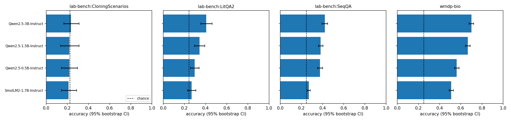

# Results

Auto-generated by `python -m bioeval.analyze`. Items scored: 2105 unique, 67360 predictions.

## Accuracy (mean over option-order rotations; 95% bootstrap CI over questions; one-sided binomial test vs chance)
| model | template | task | n_questions | accuracy | ci_low | ci_high | chance | above_chance_p |
|---|---|---|---|---|---|---|---|---|
| HuggingFaceTB/SmolLM2-1.7B-Instruct | chat | lab-bench:CloningScenarios | 33 | 0.250 | 0.197 | 0.303 | 0.226 | 0.896 |
| Qwen/Qwen2.5-3B-Instruct | chat | lab-bench:CloningScenarios | 33 | 0.242 | 0.167 | 0.326 | 0.226 | 0.959 |
| Qwen/Qwen2.5-1.5B-Instruct | chat | lab-bench:CloningScenarios | 33 | 0.220 | 0.151 | 0.295 | 0.226 | 0.642 |
| Qwen/Qwen2.5-0.5B-Instruct | chat | lab-bench:CloningScenarios | 33 | 0.174 | 0.121 | 0.220 | 0.226 | 0.896 |
| HuggingFaceTB/SmolLM2-1.7B-Instruct | plain | lab-bench:CloningScenarios | 33 | 0.235 | 0.167 | 0.311 | 0.226 | 0.477 |
| Qwen/Qwen2.5-1.5B-Instruct | plain | lab-bench:CloningScenarios | 33 | 0.220 | 0.144 | 0.295 | 0.226 | 0.788 |
| Qwen/Qwen2.5-3B-Instruct | plain | lab-bench:CloningScenarios | 33 | 0.220 | 0.136 | 0.311 | 0.226 | 0.642 |
| Qwen/Qwen2.5-0.5B-Instruct | plain | lab-bench:CloningScenarios | 33 | 0.212 | 0.144 | 0.288 | 0.226 | 0.642 |
| Qwen/Qwen2.5-3B-Instruct | chat | lab-bench:LitQA2 | 199 | 0.369 | 0.323 | 0.418 | 0.244 | 0.000 |
| Qwen/Qwen2.5-1.5B-Instruct | chat | lab-bench:LitQA2 | 199 | 0.317 | 0.271 | 0.363 | 0.244 | 0.039 |
| Qwen/Qwen2.5-0.5B-Instruct | chat | lab-bench:LitQA2 | 199 | 0.276 | 0.239 | 0.317 | 0.244 | 0.568 |
| HuggingFaceTB/SmolLM2-1.7B-Instruct | chat | lab-bench:LitQA2 | 199 | 0.275 | 0.239 | 0.314 | 0.244 | 0.258 |
| Qwen/Qwen2.5-3B-Instruct | plain | lab-bench:LitQA2 | 199 | 0.406 | 0.354 | 0.462 | 0.244 | 0.000 |
| Qwen/Qwen2.5-1.5B-Instruct | plain | lab-bench:LitQA2 | 199 | 0.344 | 0.295 | 0.393 | 0.244 | 0.001 |
| Qwen/Qwen2.5-0.5B-Instruct | plain | lab-bench:LitQA2 | 199 | 0.298 | 0.256 | 0.340 | 0.244 | 0.129 |
| HuggingFaceTB/SmolLM2-1.7B-Instruct | plain | lab-bench:LitQA2 | 199 | 0.269 | 0.230 | 0.309 | 0.244 | 0.054 |
| Qwen/Qwen2.5-0.5B-Instruct | chat | lab-bench:SeqQA | 600 | 0.362 | 0.343 | 0.382 | 0.247 | 0.000 |
| Qwen/Qwen2.5-3B-Instruct | chat | lab-bench:SeqQA | 600 | 0.350 | 0.326 | 0.373 | 0.247 | 0.000 |
| HuggingFaceTB/SmolLM2-1.7B-Instruct | chat | lab-bench:SeqQA | 600 | 0.320 | 0.298 | 0.340 | 0.247 | 0.000 |
| Qwen/Qwen2.5-1.5B-Instruct | chat | lab-bench:SeqQA | 600 | 0.307 | 0.291 | 0.323 | 0.247 | 0.000 |
| Qwen/Qwen2.5-3B-Instruct | plain | lab-bench:SeqQA | 600 | 0.422 | 0.394 | 0.448 | 0.247 | 0.000 |
| Qwen/Qwen2.5-0.5B-Instruct | plain | lab-bench:SeqQA | 600 | 0.381 | 0.360 | 0.405 | 0.247 | 0.000 |
| Qwen/Qwen2.5-1.5B-Instruct | plain | lab-bench:SeqQA | 600 | 0.375 | 0.352 | 0.400 | 0.247 | 0.000 |
| HuggingFaceTB/SmolLM2-1.7B-Instruct | plain | lab-bench:SeqQA | 600 | 0.270 | 0.255 | 0.284 | 0.247 | 0.014 |
| Qwen/Qwen2.5-3B-Instruct | chat | wmdp-bio | 1273 | 0.680 | 0.658 | 0.702 | 0.250 | 0.000 |
| Qwen/Qwen2.5-1.5B-Instruct | chat | wmdp-bio | 1273 | 0.655 | 0.634 | 0.676 | 0.250 | 0.000 |
| Qwen/Qwen2.5-0.5B-Instruct | chat | wmdp-bio | 1273 | 0.523 | 0.501 | 0.544 | 0.250 | 0.000 |
| HuggingFaceTB/SmolLM2-1.7B-Instruct | chat | wmdp-bio | 1273 | 0.497 | 0.478 | 0.516 | 0.250 | 0.000 |
| Qwen/Qwen2.5-3B-Instruct | plain | wmdp-bio | 1273 | 0.700 | 0.678 | 0.722 | 0.250 | 0.000 |
| Qwen/Qwen2.5-1.5B-Instruct | plain | wmdp-bio | 1273 | 0.667 | 0.643 | 0.689 | 0.250 | 0.000 |
| Qwen/Qwen2.5-0.5B-Instruct | plain | wmdp-bio | 1273 | 0.562 | 0.540 | 0.583 | 0.250 | 0.000 |
| HuggingFaceTB/SmolLM2-1.7B-Instruct | plain | wmdp-bio | 1273 | 0.509 | 0.489 | 0.530 | 0.250 | 0.000 |

## Position bias (share of predictions per letter slot; chi-square vs uniform)
| model | template | task | chi2 | p | max_slot_share | slot_A | slot_B | slot_C | slot_D |
|---|---|---|---|---|---|---|---|---|---|
| HuggingFaceTB/SmolLM2-1.7B-Instruct | chat | lab-bench:CloningScenarios | 33.530 | 0.000 | 0.436 | 0.060 | 0.274 | 0.436 | 0.231 |
| HuggingFaceTB/SmolLM2-1.7B-Instruct | chat | lab-bench:LitQA2 | 84.912 | 0.000 | 0.373 | 0.181 | 0.281 | 0.373 | 0.164 |
| HuggingFaceTB/SmolLM2-1.7B-Instruct | chat | lab-bench:SeqQA | 113.334 | 0.000 | 0.330 | 0.209 | 0.271 | 0.191 | 0.330 |
| HuggingFaceTB/SmolLM2-1.7B-Instruct | chat | wmdp-bio | 420.643 | 0.000 | 0.315 | 0.288 | 0.269 | 0.315 | 0.129 |
| HuggingFaceTB/SmolLM2-1.7B-Instruct | plain | lab-bench:CloningScenarios | 8.861 | 0.031 | 0.339 | 0.174 | 0.296 | 0.191 | 0.339 |
| HuggingFaceTB/SmolLM2-1.7B-Instruct | plain | lab-bench:LitQA2 | 295.692 | 0.000 | 0.502 | 0.502 | 0.220 | 0.199 | 0.079 |
| HuggingFaceTB/SmolLM2-1.7B-Instruct | plain | lab-bench:SeqQA | 797.438 | 0.000 | 0.445 | 0.445 | 0.270 | 0.252 | 0.033 |
| HuggingFaceTB/SmolLM2-1.7B-Instruct | plain | wmdp-bio | 1218.655 | 0.000 | 0.451 | 0.451 | 0.236 | 0.186 | 0.127 |
| Qwen/Qwen2.5-0.5B-Instruct | chat | lab-bench:CloningScenarios | 21.051 | 0.000 | 0.364 | 0.085 | 0.314 | 0.364 | 0.237 |
| Qwen/Qwen2.5-0.5B-Instruct | chat | lab-bench:LitQA2 | 127.880 | 0.000 | 0.424 | 0.132 | 0.174 | 0.270 | 0.424 |
| Qwen/Qwen2.5-0.5B-Instruct | chat | lab-bench:SeqQA | 740.079 | 0.000 | 0.449 | 0.050 | 0.245 | 0.256 | 0.449 |
| Qwen/Qwen2.5-0.5B-Instruct | chat | wmdp-bio | 341.057 | 0.000 | 0.326 | 0.170 | 0.204 | 0.300 | 0.326 |
| Qwen/Qwen2.5-0.5B-Instruct | plain | lab-bench:CloningScenarios | 27.438 | 0.000 | 0.367 | 0.211 | 0.344 | 0.367 | 0.078 |
| Qwen/Qwen2.5-0.5B-Instruct | plain | lab-bench:LitQA2 | 290.373 | 0.000 | 0.484 | 0.484 | 0.266 | 0.187 | 0.063 |
| Qwen/Qwen2.5-0.5B-Instruct | plain | lab-bench:SeqQA | 1001.456 | 0.000 | 0.500 | 0.500 | 0.226 | 0.225 | 0.049 |
| Qwen/Qwen2.5-0.5B-Instruct | plain | wmdp-bio | 473.114 | 0.000 | 0.353 | 0.353 | 0.268 | 0.238 | 0.140 |
| Qwen/Qwen2.5-1.5B-Instruct | chat | lab-bench:CloningScenarios | 14.008 | 0.003 | 0.394 | 0.394 | 0.205 | 0.205 | 0.197 |
| Qwen/Qwen2.5-1.5B-Instruct | chat | lab-bench:LitQA2 | 147.129 | 0.000 | 0.392 | 0.392 | 0.277 | 0.245 | 0.087 |
| Qwen/Qwen2.5-1.5B-Instruct | chat | lab-bench:SeqQA | 1318.654 | 0.000 | 0.550 | 0.550 | 0.198 | 0.211 | 0.042 |
| Qwen/Qwen2.5-1.5B-Instruct | chat | wmdp-bio | 60.162 | 0.000 | 0.282 | 0.282 | 0.261 | 0.249 | 0.208 |
| Qwen/Qwen2.5-1.5B-Instruct | plain | lab-bench:CloningScenarios | 1.976 | 0.577 | 0.291 | 0.268 | 0.291 | 0.228 | 0.213 |
| Qwen/Qwen2.5-1.5B-Instruct | plain | lab-bench:LitQA2 | 151.604 | 0.000 | 0.434 | 0.434 | 0.228 | 0.202 | 0.137 |
| Qwen/Qwen2.5-1.5B-Instruct | plain | lab-bench:SeqQA | 948.578 | 0.000 | 0.508 | 0.508 | 0.245 | 0.134 | 0.113 |
| Qwen/Qwen2.5-1.5B-Instruct | plain | wmdp-bio | 82.691 | 0.000 | 0.304 | 0.304 | 0.244 | 0.224 | 0.229 |
| Qwen/Qwen2.5-3B-Instruct | chat | lab-bench:CloningScenarios | 9.344 | 0.025 | 0.303 | 0.131 | 0.287 | 0.303 | 0.279 |
| Qwen/Qwen2.5-3B-Instruct | chat | lab-bench:LitQA2 | 170.081 | 0.000 | 0.431 | 0.431 | 0.280 | 0.161 | 0.128 |
| Qwen/Qwen2.5-3B-Instruct | chat | lab-bench:SeqQA | 370.718 | 0.000 | 0.399 | 0.399 | 0.231 | 0.247 | 0.123 |
| Qwen/Qwen2.5-3B-Instruct | chat | wmdp-bio | 82.218 | 0.000 | 0.301 | 0.301 | 0.251 | 0.223 | 0.225 |
| Qwen/Qwen2.5-3B-Instruct | plain | lab-bench:CloningScenarios | 6.635 | 0.084 | 0.333 | 0.214 | 0.333 | 0.183 | 0.270 |
| Qwen/Qwen2.5-3B-Instruct | plain | lab-bench:LitQA2 | 97.863 | 0.000 | 0.362 | 0.313 | 0.362 | 0.176 | 0.149 |
| Qwen/Qwen2.5-3B-Instruct | plain | lab-bench:SeqQA | 232.161 | 0.000 | 0.358 | 0.290 | 0.358 | 0.172 | 0.180 |
| Qwen/Qwen2.5-3B-Instruct | plain | wmdp-bio | 42.947 | 0.000 | 0.276 | 0.276 | 0.269 | 0.229 | 0.225 |

## Robustness to option order (needs `--n-shifts > 1`)
| model | template | task | acc_min | acc_max | acc_range | consistency |
|---|---|---|---|---|---|---|
| HuggingFaceTB/SmolLM2-1.7B-Instruct | chat | lab-bench:CloningScenarios | 0.152 | 0.333 | 0.182 | 0.000 |
| HuggingFaceTB/SmolLM2-1.7B-Instruct | chat | lab-bench:LitQA2 | 0.251 | 0.322 | 0.070 | 0.106 |
| HuggingFaceTB/SmolLM2-1.7B-Instruct | chat | lab-bench:SeqQA | 0.303 | 0.335 | 0.032 | 0.030 |
| HuggingFaceTB/SmolLM2-1.7B-Instruct | chat | wmdp-bio | 0.487 | 0.505 | 0.018 | 0.213 |
| HuggingFaceTB/SmolLM2-1.7B-Instruct | plain | lab-bench:CloningScenarios | 0.182 | 0.303 | 0.121 | 0.000 |
| HuggingFaceTB/SmolLM2-1.7B-Instruct | plain | lab-bench:LitQA2 | 0.216 | 0.296 | 0.080 | 0.136 |
| HuggingFaceTB/SmolLM2-1.7B-Instruct | plain | lab-bench:SeqQA | 0.257 | 0.287 | 0.030 | 0.017 |
| HuggingFaceTB/SmolLM2-1.7B-Instruct | plain | wmdp-bio | 0.495 | 0.526 | 0.031 | 0.332 |
| Qwen/Qwen2.5-0.5B-Instruct | chat | lab-bench:CloningScenarios | 0.061 | 0.303 | 0.242 | 0.030 |
| Qwen/Qwen2.5-0.5B-Instruct | chat | lab-bench:LitQA2 | 0.241 | 0.342 | 0.101 | 0.095 |
| Qwen/Qwen2.5-0.5B-Instruct | chat | lab-bench:SeqQA | 0.342 | 0.388 | 0.047 | 0.040 |
| Qwen/Qwen2.5-0.5B-Instruct | chat | wmdp-bio | 0.515 | 0.530 | 0.016 | 0.381 |
| Qwen/Qwen2.5-0.5B-Instruct | plain | lab-bench:CloningScenarios | 0.152 | 0.242 | 0.091 | 0.030 |
| Qwen/Qwen2.5-0.5B-Instruct | plain | lab-bench:LitQA2 | 0.281 | 0.312 | 0.030 | 0.191 |
| Qwen/Qwen2.5-0.5B-Instruct | plain | lab-bench:SeqQA | 0.368 | 0.407 | 0.038 | 0.083 |
| Qwen/Qwen2.5-0.5B-Instruct | plain | wmdp-bio | 0.547 | 0.573 | 0.026 | 0.444 |
| Qwen/Qwen2.5-1.5B-Instruct | chat | lab-bench:CloningScenarios | 0.182 | 0.273 | 0.091 | 0.061 |
| Qwen/Qwen2.5-1.5B-Instruct | chat | lab-bench:LitQA2 | 0.261 | 0.362 | 0.101 | 0.241 |
| Qwen/Qwen2.5-1.5B-Instruct | chat | lab-bench:SeqQA | 0.282 | 0.325 | 0.043 | 0.012 |
| Qwen/Qwen2.5-1.5B-Instruct | chat | wmdp-bio | 0.646 | 0.673 | 0.027 | 0.632 |
| Qwen/Qwen2.5-1.5B-Instruct | plain | lab-bench:CloningScenarios | 0.152 | 0.333 | 0.182 | 0.061 |
| Qwen/Qwen2.5-1.5B-Instruct | plain | lab-bench:LitQA2 | 0.312 | 0.362 | 0.050 | 0.317 |
| Qwen/Qwen2.5-1.5B-Instruct | plain | lab-bench:SeqQA | 0.358 | 0.388 | 0.030 | 0.093 |
| Qwen/Qwen2.5-1.5B-Instruct | plain | wmdp-bio | 0.657 | 0.676 | 0.020 | 0.676 |
| Qwen/Qwen2.5-3B-Instruct | chat | lab-bench:CloningScenarios | 0.121 | 0.303 | 0.182 | 0.091 |
| Qwen/Qwen2.5-3B-Instruct | chat | lab-bench:LitQA2 | 0.352 | 0.382 | 0.030 | 0.271 |
| Qwen/Qwen2.5-3B-Instruct | chat | lab-bench:SeqQA | 0.320 | 0.360 | 0.040 | 0.108 |
| Qwen/Qwen2.5-3B-Instruct | chat | wmdp-bio | 0.676 | 0.683 | 0.007 | 0.673 |
| Qwen/Qwen2.5-3B-Instruct | plain | lab-bench:CloningScenarios | 0.212 | 0.242 | 0.030 | 0.182 |
| Qwen/Qwen2.5-3B-Instruct | plain | lab-bench:LitQA2 | 0.352 | 0.447 | 0.095 | 0.342 |
| Qwen/Qwen2.5-3B-Instruct | plain | lab-bench:SeqQA | 0.412 | 0.442 | 0.030 | 0.177 |
| Qwen/Qwen2.5-3B-Instruct | plain | wmdp-bio | 0.697 | 0.705 | 0.008 | 0.712 |

## Calibration (ECE, 10 bins)
| model | template | task | ece | mean_conf | accuracy |
|---|---|---|---|---|---|
| HuggingFaceTB/SmolLM2-1.7B-Instruct | chat | lab-bench:CloningScenarios | 0.226 | 0.476 | 0.250 |
| HuggingFaceTB/SmolLM2-1.7B-Instruct | chat | lab-bench:LitQA2 | 0.265 | 0.541 | 0.275 |
| HuggingFaceTB/SmolLM2-1.7B-Instruct | chat | lab-bench:SeqQA | 0.111 | 0.429 | 0.320 |
| HuggingFaceTB/SmolLM2-1.7B-Instruct | chat | wmdp-bio | 0.254 | 0.751 | 0.497 |
| HuggingFaceTB/SmolLM2-1.7B-Instruct | plain | lab-bench:CloningScenarios | 0.218 | 0.441 | 0.235 |
| HuggingFaceTB/SmolLM2-1.7B-Instruct | plain | lab-bench:LitQA2 | 0.244 | 0.511 | 0.269 |
| HuggingFaceTB/SmolLM2-1.7B-Instruct | plain | lab-bench:SeqQA | 0.242 | 0.510 | 0.270 |
| HuggingFaceTB/SmolLM2-1.7B-Instruct | plain | wmdp-bio | 0.258 | 0.767 | 0.509 |
| Qwen/Qwen2.5-0.5B-Instruct | chat | lab-bench:CloningScenarios | 0.263 | 0.437 | 0.174 |
| Qwen/Qwen2.5-0.5B-Instruct | chat | lab-bench:LitQA2 | 0.197 | 0.473 | 0.276 |
| Qwen/Qwen2.5-0.5B-Instruct | chat | lab-bench:SeqQA | 0.023 | 0.376 | 0.362 |
| Qwen/Qwen2.5-0.5B-Instruct | chat | wmdp-bio | 0.083 | 0.605 | 0.523 |
| Qwen/Qwen2.5-0.5B-Instruct | plain | lab-bench:CloningScenarios | 0.206 | 0.416 | 0.212 |
| Qwen/Qwen2.5-0.5B-Instruct | plain | lab-bench:LitQA2 | 0.228 | 0.523 | 0.298 |
| Qwen/Qwen2.5-0.5B-Instruct | plain | lab-bench:SeqQA | 0.066 | 0.439 | 0.381 |
| Qwen/Qwen2.5-0.5B-Instruct | plain | wmdp-bio | 0.202 | 0.763 | 0.562 |
| Qwen/Qwen2.5-1.5B-Instruct | chat | lab-bench:CloningScenarios | 0.287 | 0.507 | 0.220 |
| Qwen/Qwen2.5-1.5B-Instruct | chat | lab-bench:LitQA2 | 0.362 | 0.679 | 0.317 |
| Qwen/Qwen2.5-1.5B-Instruct | chat | lab-bench:SeqQA | 0.221 | 0.528 | 0.307 |
| Qwen/Qwen2.5-1.5B-Instruct | chat | wmdp-bio | 0.214 | 0.868 | 0.655 |
| Qwen/Qwen2.5-1.5B-Instruct | plain | lab-bench:CloningScenarios | 0.258 | 0.468 | 0.220 |
| Qwen/Qwen2.5-1.5B-Instruct | plain | lab-bench:LitQA2 | 0.228 | 0.572 | 0.344 |
| Qwen/Qwen2.5-1.5B-Instruct | plain | lab-bench:SeqQA | 0.096 | 0.471 | 0.375 |
| Qwen/Qwen2.5-1.5B-Instruct | plain | wmdp-bio | 0.152 | 0.819 | 0.667 |
| Qwen/Qwen2.5-3B-Instruct | chat | lab-bench:CloningScenarios | 0.419 | 0.655 | 0.242 |
| Qwen/Qwen2.5-3B-Instruct | chat | lab-bench:LitQA2 | 0.466 | 0.835 | 0.369 |
| Qwen/Qwen2.5-3B-Instruct | chat | lab-bench:SeqQA | 0.390 | 0.740 | 0.350 |
| Qwen/Qwen2.5-3B-Instruct | chat | wmdp-bio | 0.268 | 0.948 | 0.680 |
| Qwen/Qwen2.5-3B-Instruct | plain | lab-bench:CloningScenarios | 0.437 | 0.650 | 0.220 |
| Qwen/Qwen2.5-3B-Instruct | plain | lab-bench:LitQA2 | 0.255 | 0.661 | 0.406 |
| Qwen/Qwen2.5-3B-Instruct | plain | lab-bench:SeqQA | 0.182 | 0.604 | 0.422 |
| Qwen/Qwen2.5-3B-Instruct | plain | wmdp-bio | 0.206 | 0.906 | 0.700 |

## Prompt-template sensitivity (needs `--templates plain chat`)
| model | task | chat | plain | abs_diff |
|---|---|---|---|---|
| HuggingFaceTB/SmolLM2-1.7B-Instruct | lab-bench:CloningScenarios | 0.250 | 0.235 | 0.015 |
| HuggingFaceTB/SmolLM2-1.7B-Instruct | lab-bench:LitQA2 | 0.275 | 0.269 | 0.006 |
| HuggingFaceTB/SmolLM2-1.7B-Instruct | lab-bench:SeqQA | 0.320 | 0.270 | 0.050 |
| HuggingFaceTB/SmolLM2-1.7B-Instruct | wmdp-bio | 0.497 | 0.509 | 0.012 |
| Qwen/Qwen2.5-0.5B-Instruct | lab-bench:CloningScenarios | 0.174 | 0.212 | 0.038 |
| Qwen/Qwen2.5-0.5B-Instruct | lab-bench:LitQA2 | 0.276 | 0.298 | 0.021 |
| Qwen/Qwen2.5-0.5B-Instruct | lab-bench:SeqQA | 0.362 | 0.381 | 0.019 |
| Qwen/Qwen2.5-0.5B-Instruct | wmdp-bio | 0.523 | 0.562 | 0.039 |
| Qwen/Qwen2.5-1.5B-Instruct | lab-bench:CloningScenarios | 0.220 | 0.220 | 0.000 |
| Qwen/Qwen2.5-1.5B-Instruct | lab-bench:LitQA2 | 0.317 | 0.344 | 0.028 |
| Qwen/Qwen2.5-1.5B-Instruct | lab-bench:SeqQA | 0.307 | 0.375 | 0.068 |
| Qwen/Qwen2.5-1.5B-Instruct | wmdp-bio | 0.655 | 0.667 | 0.011 |
| Qwen/Qwen2.5-3B-Instruct | lab-bench:CloningScenarios | 0.242 | 0.220 | 0.023 |
| Qwen/Qwen2.5-3B-Instruct | lab-bench:LitQA2 | 0.369 | 0.406 | 0.036 |
| Qwen/Qwen2.5-3B-Instruct | lab-bench:SeqQA | 0.350 | 0.422 | 0.072 |
| Qwen/Qwen2.5-3B-Instruct | wmdp-bio | 0.680 | 0.700 | 0.020 |

## Do models fail on the same questions? (Cohen's kappa of correctness)
| task | model_a | model_b | kappa |
|---|---|---|---|
| lab-bench:CloningScenarios | HuggingFaceTB/SmolLM2-1.7B-Instruct | Qwen/Qwen2.5-0.5B-Instruct | 0.052 |
| lab-bench:CloningScenarios | HuggingFaceTB/SmolLM2-1.7B-Instruct | Qwen/Qwen2.5-1.5B-Instruct | 0.098 |
| lab-bench:CloningScenarios | HuggingFaceTB/SmolLM2-1.7B-Instruct | Qwen/Qwen2.5-3B-Instruct | -0.120 |
| lab-bench:CloningScenarios | Qwen/Qwen2.5-0.5B-Instruct | Qwen/Qwen2.5-1.5B-Instruct | 0.330 |
| lab-bench:CloningScenarios | Qwen/Qwen2.5-0.5B-Instruct | Qwen/Qwen2.5-3B-Instruct | 0.275 |
| lab-bench:CloningScenarios | Qwen/Qwen2.5-1.5B-Instruct | Qwen/Qwen2.5-3B-Instruct | -0.052 |
| lab-bench:LitQA2 | HuggingFaceTB/SmolLM2-1.7B-Instruct | Qwen/Qwen2.5-0.5B-Instruct | 0.352 |
| lab-bench:LitQA2 | HuggingFaceTB/SmolLM2-1.7B-Instruct | Qwen/Qwen2.5-1.5B-Instruct | 0.227 |
| lab-bench:LitQA2 | HuggingFaceTB/SmolLM2-1.7B-Instruct | Qwen/Qwen2.5-3B-Instruct | 0.195 |
| lab-bench:LitQA2 | Qwen/Qwen2.5-0.5B-Instruct | Qwen/Qwen2.5-1.5B-Instruct | 0.440 |
| lab-bench:LitQA2 | Qwen/Qwen2.5-0.5B-Instruct | Qwen/Qwen2.5-3B-Instruct | 0.353 |
| lab-bench:LitQA2 | Qwen/Qwen2.5-1.5B-Instruct | Qwen/Qwen2.5-3B-Instruct | 0.450 |
| lab-bench:SeqQA | HuggingFaceTB/SmolLM2-1.7B-Instruct | Qwen/Qwen2.5-0.5B-Instruct | 0.189 |
| lab-bench:SeqQA | HuggingFaceTB/SmolLM2-1.7B-Instruct | Qwen/Qwen2.5-1.5B-Instruct | 0.285 |
| lab-bench:SeqQA | HuggingFaceTB/SmolLM2-1.7B-Instruct | Qwen/Qwen2.5-3B-Instruct | 0.197 |
| lab-bench:SeqQA | Qwen/Qwen2.5-0.5B-Instruct | Qwen/Qwen2.5-1.5B-Instruct | 0.434 |
| lab-bench:SeqQA | Qwen/Qwen2.5-0.5B-Instruct | Qwen/Qwen2.5-3B-Instruct | 0.322 |
| lab-bench:SeqQA | Qwen/Qwen2.5-1.5B-Instruct | Qwen/Qwen2.5-3B-Instruct | 0.420 |
| wmdp-bio | HuggingFaceTB/SmolLM2-1.7B-Instruct | Qwen/Qwen2.5-0.5B-Instruct | 0.446 |
| wmdp-bio | HuggingFaceTB/SmolLM2-1.7B-Instruct | Qwen/Qwen2.5-1.5B-Instruct | 0.394 |
| wmdp-bio | HuggingFaceTB/SmolLM2-1.7B-Instruct | Qwen/Qwen2.5-3B-Instruct | 0.365 |
| wmdp-bio | Qwen/Qwen2.5-0.5B-Instruct | Qwen/Qwen2.5-1.5B-Instruct | 0.489 |
| wmdp-bio | Qwen/Qwen2.5-0.5B-Instruct | Qwen/Qwen2.5-3B-Instruct | 0.411 |
| wmdp-bio | Qwen/Qwen2.5-1.5B-Instruct | Qwen/Qwen2.5-3B-Instruct | 0.568 |

| task | n_items | n_models | solved_by_none | solved_by_all |
|---|---|---|---|---|
| lab-bench:CloningScenarios | 33 | 4 | 0.455 | 0.000 |
| lab-bench:LitQA2 | 199 | 4 | 0.357 | 0.101 |
| lab-bench:SeqQA | 600 | 4 | 0.300 | 0.113 |
| wmdp-bio | 1273 | 4 | 0.159 | 0.363 |

## Accuracy by prompt-length quartile
| model | task | length_quartile | n | accuracy |
|---|---|---|---|---|
| HuggingFaceTB/SmolLM2-1.7B-Instruct | lab-bench:LitQA2 | Q1 short | 52 | 0.346 |
| HuggingFaceTB/SmolLM2-1.7B-Instruct | lab-bench:LitQA2 | Q2 | 48 | 0.271 |
| HuggingFaceTB/SmolLM2-1.7B-Instruct | lab-bench:LitQA2 | Q3 | 49 | 0.245 |
| HuggingFaceTB/SmolLM2-1.7B-Instruct | lab-bench:LitQA2 | Q4 long | 50 | 0.320 |
| HuggingFaceTB/SmolLM2-1.7B-Instruct | lab-bench:SeqQA | Q1 short | 150 | 0.273 |
| HuggingFaceTB/SmolLM2-1.7B-Instruct | lab-bench:SeqQA | Q2 | 153 | 0.307 |
| HuggingFaceTB/SmolLM2-1.7B-Instruct | lab-bench:SeqQA | Q3 | 147 | 0.340 |
| HuggingFaceTB/SmolLM2-1.7B-Instruct | lab-bench:SeqQA | Q4 long | 150 | 0.227 |
| HuggingFaceTB/SmolLM2-1.7B-Instruct | wmdp-bio | Q1 short | 324 | 0.509 |
| HuggingFaceTB/SmolLM2-1.7B-Instruct | wmdp-bio | Q2 | 316 | 0.532 |
| HuggingFaceTB/SmolLM2-1.7B-Instruct | wmdp-bio | Q3 | 319 | 0.571 |
| HuggingFaceTB/SmolLM2-1.7B-Instruct | wmdp-bio | Q4 long | 314 | 0.490 |
| Qwen/Qwen2.5-0.5B-Instruct | lab-bench:LitQA2 | Q1 short | 52 | 0.327 |
| Qwen/Qwen2.5-0.5B-Instruct | lab-bench:LitQA2 | Q2 | 52 | 0.346 |
| Qwen/Qwen2.5-0.5B-Instruct | lab-bench:LitQA2 | Q3 | 50 | 0.160 |
| Qwen/Qwen2.5-0.5B-Instruct | lab-bench:LitQA2 | Q4 long | 45 | 0.289 |
| Qwen/Qwen2.5-0.5B-Instruct | lab-bench:SeqQA | Q1 short | 154 | 0.565 |
| Qwen/Qwen2.5-0.5B-Instruct | lab-bench:SeqQA | Q2 | 151 | 0.384 |
| Qwen/Qwen2.5-0.5B-Instruct | lab-bench:SeqQA | Q3 | 145 | 0.331 |
| Qwen/Qwen2.5-0.5B-Instruct | lab-bench:SeqQA | Q4 long | 150 | 0.340 |
| Qwen/Qwen2.5-0.5B-Instruct | wmdp-bio | Q1 short | 323 | 0.551 |
| Qwen/Qwen2.5-0.5B-Instruct | wmdp-bio | Q2 | 315 | 0.537 |
| Qwen/Qwen2.5-0.5B-Instruct | wmdp-bio | Q3 | 320 | 0.619 |
| Qwen/Qwen2.5-0.5B-Instruct | wmdp-bio | Q4 long | 315 | 0.578 |
| Qwen/Qwen2.5-1.5B-Instruct | lab-bench:LitQA2 | Q1 short | 52 | 0.346 |
| Qwen/Qwen2.5-1.5B-Instruct | lab-bench:LitQA2 | Q2 | 52 | 0.442 |
| Qwen/Qwen2.5-1.5B-Instruct | lab-bench:LitQA2 | Q3 | 50 | 0.220 |
| Qwen/Qwen2.5-1.5B-Instruct | lab-bench:LitQA2 | Q4 long | 45 | 0.356 |
| Qwen/Qwen2.5-1.5B-Instruct | lab-bench:SeqQA | Q1 short | 154 | 0.558 |
| Qwen/Qwen2.5-1.5B-Instruct | lab-bench:SeqQA | Q2 | 151 | 0.338 |
| Qwen/Qwen2.5-1.5B-Instruct | lab-bench:SeqQA | Q3 | 145 | 0.345 |
| Qwen/Qwen2.5-1.5B-Instruct | lab-bench:SeqQA | Q4 long | 150 | 0.260 |
| Qwen/Qwen2.5-1.5B-Instruct | wmdp-bio | Q1 short | 323 | 0.619 |
| Qwen/Qwen2.5-1.5B-Instruct | wmdp-bio | Q2 | 315 | 0.673 |
| Qwen/Qwen2.5-1.5B-Instruct | wmdp-bio | Q3 | 320 | 0.731 |
| Qwen/Qwen2.5-1.5B-Instruct | wmdp-bio | Q4 long | 315 | 0.679 |
| Qwen/Qwen2.5-3B-Instruct | lab-bench:LitQA2 | Q1 short | 52 | 0.404 |
| Qwen/Qwen2.5-3B-Instruct | lab-bench:LitQA2 | Q2 | 52 | 0.481 |
| Qwen/Qwen2.5-3B-Instruct | lab-bench:LitQA2 | Q3 | 50 | 0.360 |
| Qwen/Qwen2.5-3B-Instruct | lab-bench:LitQA2 | Q4 long | 45 | 0.444 |
| Qwen/Qwen2.5-3B-Instruct | lab-bench:SeqQA | Q1 short | 154 | 0.591 |
| Qwen/Qwen2.5-3B-Instruct | lab-bench:SeqQA | Q2 | 151 | 0.464 |
| Qwen/Qwen2.5-3B-Instruct | lab-bench:SeqQA | Q3 | 145 | 0.372 |
| Qwen/Qwen2.5-3B-Instruct | lab-bench:SeqQA | Q4 long | 150 | 0.333 |
| Qwen/Qwen2.5-3B-Instruct | wmdp-bio | Q1 short | 323 | 0.619 |
| Qwen/Qwen2.5-3B-Instruct | wmdp-bio | Q2 | 315 | 0.667 |
| Qwen/Qwen2.5-3B-Instruct | wmdp-bio | Q3 | 320 | 0.759 |
| Qwen/Qwen2.5-3B-Instruct | wmdp-bio | Q4 long | 315 | 0.743 |
