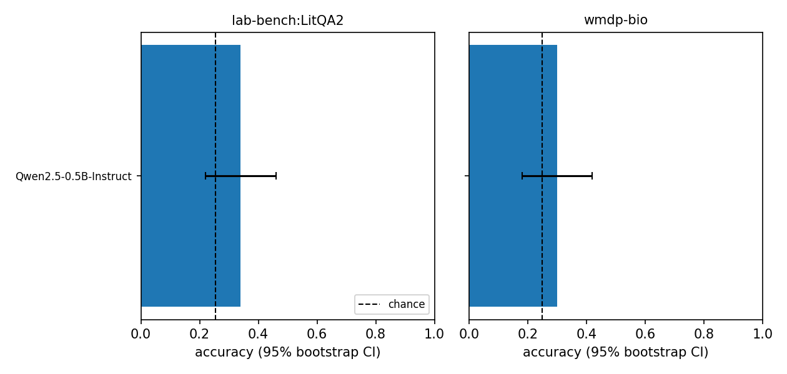

# Results

Auto-generated by `python -m bioeval.analyze`. Items scored: 100 unique, 100 predictions.

## Accuracy (mean over option-order rotations; 95% bootstrap CI over questions; one-sided binomial test vs chance)
| model | template | task | n_questions | accuracy | ci_low | ci_high | chance | above_chance_p |
|---|---|---|---|---|---|---|---|---|
| Qwen/Qwen2.5-0.5B-Instruct | plain | lab-bench:LitQA2 | 50 | 0.340 | 0.220 | 0.460 | 0.255 | 0.114 |
| Qwen/Qwen2.5-0.5B-Instruct | plain | wmdp-bio | 50 | 0.300 | 0.180 | 0.420 | 0.250 | 0.252 |

## Position bias (share of predictions per letter slot; chi-square vs uniform)
| model | template | task | chi2 | p | max_slot_share | slot_A | slot_B | slot_C | slot_D |
|---|---|---|---|---|---|---|---|---|---|
| Qwen/Qwen2.5-0.5B-Instruct | plain | lab-bench:LitQA2 | 36.319 | 0.000 | 0.596 | 0.596 | 0.277 | 0.106 | 0.021 |
| Qwen/Qwen2.5-0.5B-Instruct | plain | wmdp-bio | 16.880 | 0.001 | 0.480 | 0.480 | 0.200 | 0.240 | 0.080 |

## Robustness to option order (needs `--n-shifts > 1`)
_not available (needs more settings, e.g. --n-shifts 4 or --templates plain chat)_

## Calibration (ECE, 10 bins)
| model | template | task | ece | mean_conf | accuracy |
|---|---|---|---|---|---|
| Qwen/Qwen2.5-0.5B-Instruct | plain | lab-bench:LitQA2 | 0.206 | 0.535 | 0.340 |
| Qwen/Qwen2.5-0.5B-Instruct | plain | wmdp-bio | 0.360 | 0.660 | 0.300 |

## Prompt-template sensitivity (needs `--templates plain chat`)
_not available (needs more settings, e.g. --n-shifts 4 or --templates plain chat)_

## Do models fail on the same questions? (Cohen's kappa of correctness)
_not available (needs more settings, e.g. --n-shifts 4 or --templates plain chat)_

_not available (needs more settings, e.g. --n-shifts 4 or --templates plain chat)_

## Accuracy by prompt-length quartile
| model | task | length_quartile | n | accuracy |
|---|---|---|---|---|
| Qwen/Qwen2.5-0.5B-Instruct | lab-bench:LitQA2 | Q1 short | 14 | 0.357 |
| Qwen/Qwen2.5-0.5B-Instruct | lab-bench:LitQA2 | Q2 | 11 | 0.455 |
| Qwen/Qwen2.5-0.5B-Instruct | lab-bench:LitQA2 | Q3 | 12 | 0.333 |
| Qwen/Qwen2.5-0.5B-Instruct | lab-bench:LitQA2 | Q4 long | 13 | 0.231 |
| Qwen/Qwen2.5-0.5B-Instruct | wmdp-bio | Q1 short | 13 | 0.385 |
| Qwen/Qwen2.5-0.5B-Instruct | wmdp-bio | Q2 | 12 | 0.500 |
| Qwen/Qwen2.5-0.5B-Instruct | wmdp-bio | Q3 | 12 | 0.083 |
| Qwen/Qwen2.5-0.5B-Instruct | wmdp-bio | Q4 long | 13 | 0.231 |
